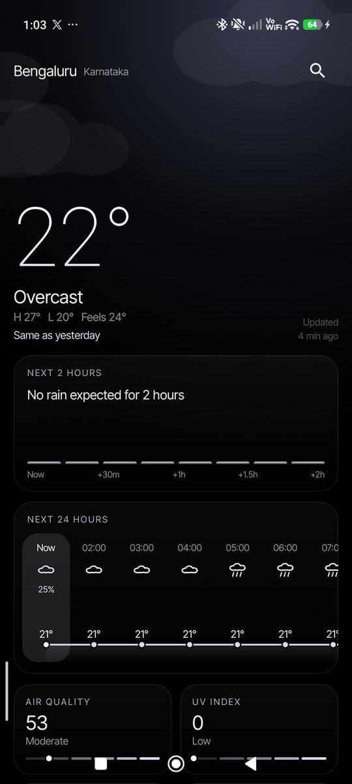
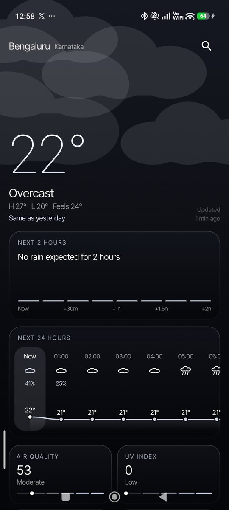
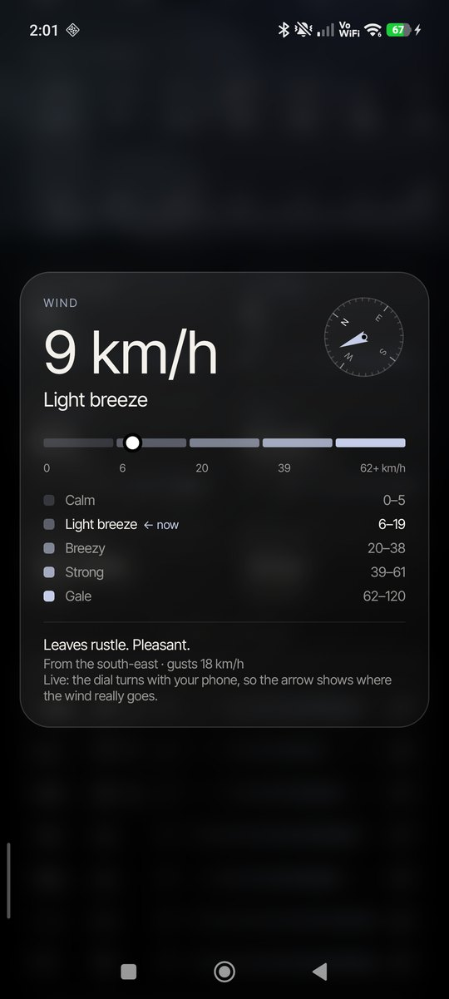
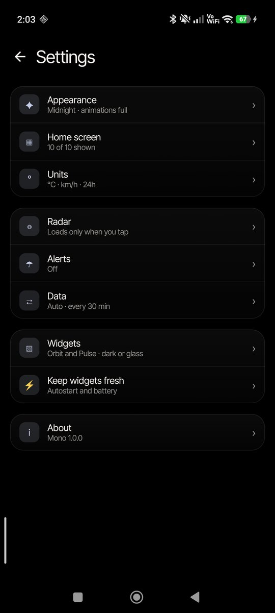
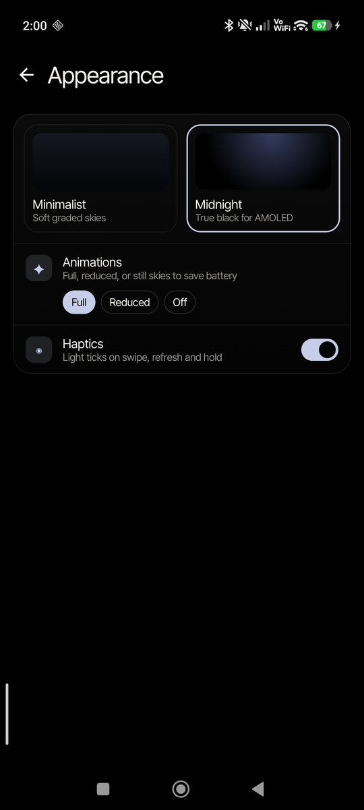
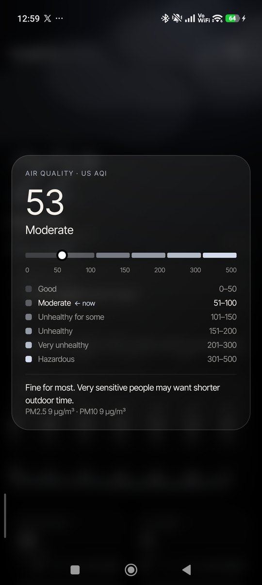
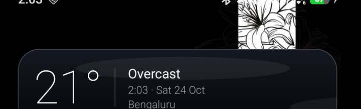

# Mono

A quiet, fast weather app for Android. Animated skies, two themes, live home-screen widgets, and a 1.4 MB install. No account, no ads, no API keys, and no location needed.

<p>
  
  
  
</p>

**[Download the latest APK](https://github.com/ItzAditya43/MonoWeather/releases/latest)** · Android 8.0 or newer (live widgets need Android 16)

## Features

- **Animated skies** drawn in real time: sun rays, stars and moon, drifting clouds, rain, snow, fog and lightning.
- **Two themes**
  - *Minimalist*: soft graded skies tinted to the weather.
  - *Midnight*: true black for AMOLED. Two soft glows near the top carry the weather's colour; everything else stays black, so those pixels stay off.
- **Heads-up**: warnings worked out from the forecast (heavy rain, storms, heat, strong wind, poor air), what to wear, your two commute times, rain today and this week, and small facts such as "wettest day since 3 Oct".
- **Living sky**: the background warms at dawn and golden hour and turns violet at dusk, using real sunrise and sunset times. It also leans slightly as you tilt the phone (can be turned off).
- **Weather sounds** (off by default): soft rain, wind, storm or night ambience, generated on the phone with no audio files, only while Mono is open.
- **Share card**: a clean image of today's weather in your theme.
- **Next 2 hours**: rain in 15-minute steps, with a plain sentence such as "Light rain now, easing by 01:00".
- **24-hour graph** (tap any hour for feels-like, wind, humidity and rain amount) and a **7-day** range view with rain totals.
- **Hold-to-expand cards** for air quality, UV, humidity and wind, each with its full scale and advice.
  - Humidity explains "feels like" (how much humidity and wind add or take away).
  - Wind has a **live compass**: the dial turns with your phone, so the arrow shows where the wind really goes.
- **Pressure** with its 3-hour trend, and **visibility** (optional tiles).
- **Rain radar**: the last 2 hours with play/pause and a scrubber. It downloads nothing until you tap Load (about 250 KB), or loads by itself on Wi-Fi if you choose. Hold the title to minimise it.
- **Sun & moon**: sun path, daylight length, golden hour, moon phase and next full moon, computed on the phone.
- **"2° warmer than yesterday"** under the temperature.
- **Multiple cities**: swipe between them. Hold a city in search to set it as the default or remove it.
- **Notifications** (optional): a live rain countdown (Android 16 Live Update; shown in the Super Island on HyperOS 3.1 and later), commute heads-ups, warnings, and a morning summary with what to wear.
- **Quick Settings tile** with the current temperature.
- Works offline: the last forecast is saved and re-sliced to the current hour.

<p>
  
  
  
</p>

## Settings

A list of categories, each opening its own page:

- **Appearance**: theme, animations (Full, Reduced or Off to save battery), haptics.
- **Home screen**: show or hide sections. Current weather, 24 hours and 7 days always stay.
- **Units**: °C/°F; wind in km/h, mph, m/s or knots; 24h or 12h.
- **Radar**: load on Wi-Fi, start minimised.
- **Alerts**: rain threshold (40, 60 or 80%), morning summary time.
- **Data**: preferred source, refresh interval, data used this month, clear saved forecasts, and a **background refresh log** that shows whether your phone lets Mono refresh while closed.
- **Widgets**, **Keep widgets fresh** (Autostart and battery shortcuts), **About**.

## Widgets

Four designs, each in **dark** or **frosted glass**. The widget list shows the four that belong to your current theme.

| Design | Theme | What it shows |
|---|---|---|
| Type | Minimalist | One large temperature, with condition, time and city |
| Horizon | Minimalist | The next 6 hours as a single line |
| Orbit | Midnight | Today's sun path, the time, and the temperature |
| Pulse | Midnight | Rain over the next 2 hours as glowing bars |



- **Live animation.** On Android 16 the widgets use the new [Remote Compose](https://developer.android.com/blog/posts/remote-compose-gaming-widgets) engine: the home screen itself animates rain, snow, stars, sun glow and clouds while Mono is closed, and Orbit moves the sun along its arc by the clock. Older Android versions get a lighter frame-by-frame loop.
- **Glass that matches your wallpaper.** Android doesn't let apps read the wallpaper, so pick the same image once in Settings → Widgets. Tap a glass widget once and Mono learns where it sits, then blurs exactly that slice behind it.
- **A city per widget.** Choose it when adding, or long-press the widget → Reconfigure.
- Add them by long-pressing your home screen → Widgets → Mono.

### On Xiaomi / HyperOS

Xiaomi pauses background apps. In Settings → Keep widgets fresh, turn on **Autostart** and **Battery: no limits**. Even without them, widgets stay accurate for days: they read the current hour from the saved 8-day forecast, and the live widgets move the sun by the clock.

## Data and reliability

| | Source | Notes |
|---|---|---|
| Forecast | [Open-Meteo](https://open-meteo.com) | Blends ECMWF, GFS, ICON and other national models |
| Backup 1 | [MET Norway](https://api.met.no) | Used automatically if Open-Meteo fails |
| Backup 2 | [wttr.in](https://wttr.in) | Last resort; 3 days, 3-hourly |
| Air quality | Open-Meteo Air Quality | US AQI, PM2.5, PM10 |
| Radar | [RainViewer](https://www.rainviewer.com) on [Esri](https://www.esri.com) dark canvas | Loaded only on request |

You can choose which source goes first in Settings → Data; the others stay as backups. The app always shows which source answered. In regions without a short-range model, "Next 2 hours" is interpolated from hourly forecasts; the radar is the real-time check.

## Privacy

- Location is never required. Mono runs on cities you save. "Use my location once" asks for approximate location a single time and saves the result as a city.
- The compass sensor is used only while the wind card is open.
- No analytics, accounts or trackers. Requests go only to the weather and map services listed above.

## Build

Requires JDK 17 or 21 and the Android SDK (API 36).

```bash
git clone https://github.com/ItzAditya43/MonoWeather.git
cd MonoWeather
./gradlew assembleRelease        # app/build/outputs/apk/release/app-release.apk
./gradlew testReleaseUnitTest    # live checks against all three weather sources
```

Release signing is read from `~/.android-keys/mono-release.properties` (`storeFile`, `storePassword`, `keyAlias`, `keyPassword`). Without it, the build falls back to the debug key.

Stack: Kotlin, Jetpack Compose, WorkManager, Remote Compose (widgets). No Google Play Services.

## Credits

- Weather data: Open-Meteo (CC BY 4.0), MET Norway (CC BY 4.0), wttr.in
- Radar: RainViewer · Base map: Esri
- Font: [Inter Tight](https://github.com/rsms/inter-tight), SIL Open Font License 1.1 (see `FONT-LICENSE.txt`)

## License

MIT. See [LICENSE](LICENSE).
