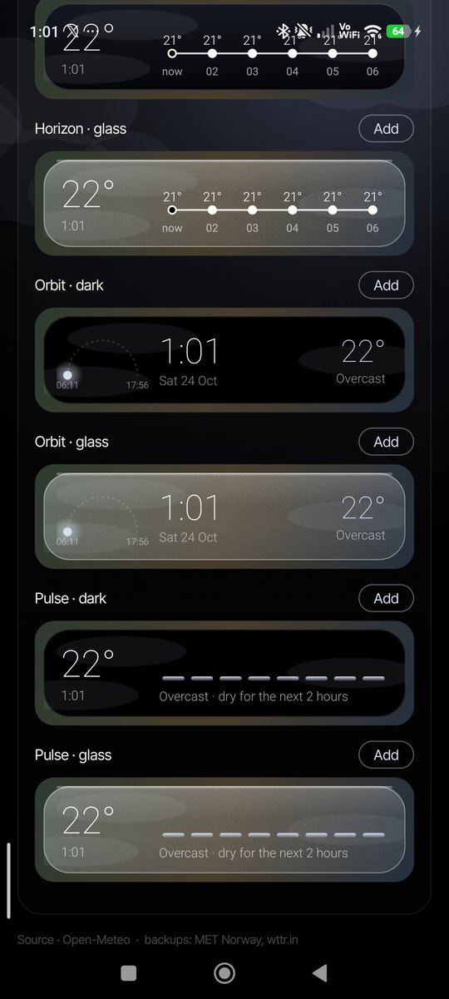

# Mono

A quiet, fast weather app for Android. Animated skies, two themes, eight home-screen widgets, and a 1.4 MB install. No account, no ads, no API keys, and no location needed.

<p>
  
  
  
</p>

**[Download the latest APK](https://github.com/ItzAditya43/MonoWeather/releases/latest)** · Android 8.0 or newer

## Features

- **Animated skies** drawn in real time: sun rays, stars and moon, drifting clouds, rain, snow, fog and lightning.
- **Two themes**
  - *Minimalist*: soft graded skies tinted to the weather.
  - *Midnight*: true black for AMOLED screens. Colour lives only in a glow near the top, so most pixels stay off.
- **Next 2 hours**: rain in 15-minute steps, with a plain sentence such as "Light rain now, easing by 01:00".
- **24-hour graph** and a **7-day** range view.
- **Hold-to-expand cards** for air quality, UV, humidity and wind. Each shows the full scale, where you are on it, and what it means. Wind includes a compass, gusts and direction.
- **Rain radar**: the last 2 hours with play/pause and a scrubber. It downloads nothing until you tap Load (about 250 KB). Hold the title to minimise it.
- **Sun & moon**: sun path, daylight length, golden hour, moon phase and next full moon, all computed on the phone.
- **"2° warmer than yesterday"** under the temperature.
- **Multiple cities**: swipe between them. Hold a city in search to set it as the widget city or remove it.
- **Alerts** (optional): rain within 2 hours, and a morning summary.
- **Quick Settings tile** with the current temperature.
- °C/°F and km/h/mph, haptics, and offline use: the last forecast is saved and re-sliced to the current hour.

## Widgets

Eight 4×1 widgets: four designs, each in **dark** or **frosted glass**. All of them animate with a gentle particle loop for the current weather.

| Design | Theme | What it shows |
|---|---|---|
| Type | Minimalist | One large temperature, with condition, time and city |
| Horizon | Minimalist | The next 6 hours as a single line |
| Orbit | Midnight | Today's sun path, the time, and the temperature |
| Pulse | Midnight | Rain over the next 2 hours as glowing bars |



Add them from the home screen's widget picker, or from **Settings → Widgets** inside the app.

### On Xiaomi / HyperOS

Xiaomi pauses background apps. In the app, go to **Settings → Keep widgets fresh** and turn on **Autostart** and **Battery: no limits**. Even without those switches, widgets stay accurate for days, because they read the current hour from the saved 8-day forecast.

## Data and reliability

| | Source | Notes |
|---|---|---|
| Forecast | [Open-Meteo](https://open-meteo.com) | Blends ECMWF, GFS, ICON and other national models |
| Backup 1 | [MET Norway](https://api.met.no) | Used automatically if Open-Meteo fails |
| Backup 2 | [wttr.in](https://wttr.in) | Last resort; 3 days, 3-hourly |
| Air quality | Open-Meteo Air Quality | US AQI, PM2.5, PM10 |
| Radar | [RainViewer](https://www.rainviewer.com) on [Esri](https://www.esri.com) dark canvas | Loaded only on request |

The app shows which source answered. In regions without a short-range model, "Next 2 hours" is interpolated from hourly forecasts; the radar is the real-time check.

## Privacy

- Location is never required. Mono runs on cities you save. "Use my location once" asks for approximate location a single time and saves the result as a city.
- No analytics, accounts or trackers. Requests go only to the weather and map services listed above.

## Build

Requires JDK 17 or 21 and the Android SDK (API 35).

```bash
git clone https://github.com/ItzAditya43/MonoWeather.git
cd MonoWeather
./gradlew assembleRelease        # app/build/outputs/apk/release/app-release.apk
./gradlew testReleaseUnitTest    # live checks against all three weather sources
```

Release signing is read from `~/.android-keys/mono-release.properties` (`storeFile`, `storePassword`, `keyAlias`, `keyPassword`). Without it, the build falls back to the debug key.

Stack: Kotlin, Jetpack Compose, WorkManager. No Google Play Services.

## Credits

- Weather data: Open-Meteo (CC BY 4.0), MET Norway (CC BY 4.0), wttr.in
- Radar: RainViewer · Base map: Esri
- Font: [Inter Tight](https://github.com/rsms/inter-tight), SIL Open Font License 1.1 (see `FONT-LICENSE.txt`)

## License

MIT. See [LICENSE](LICENSE).
